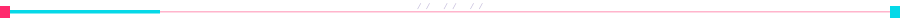

<div align="center">




<a href="https://port-folio-mine-ashy.vercel.app/"></a>
<a href="https://www.linkedin.com/in/dev-mehta-1861bb2a0/"></a>
<a href="mailto:devmehta060505@gmail.com"></a>


</div>






## `> ls ./projects --built`

| | Project | What it actually does | Stack |
|:-:|---|---|---|
| ☢️ | **[HECATE](https://github.com/TEKURU-ZENO/HECATE)** | 7 agents talk over a Kafka bus to catch incidents, trace the root cause and remediate on Kubernetes. Isolation Forest plus graph RCA, with a seed-controlled eval harness | `Kafka` `K8s` `Prometheus` `Jaeger` |
| 💸 | **[Recoup](https://github.com/TEKURU-ZENO/Recoup)** | Failed-payment recovery where a deterministic state machine decides and the LLM only writes the message. 132 tests, 20-seed paired benchmark, shadow run over 400 webhook events | `FastAPI` `Pydantic` `Razorpay` `Next.js` |
| 🧬 | **[PERSEPHONE](https://github.com/TEKURU-ZENO/PERSEPHONE)** | Virtual tumor board for precision oncology. A multi-agent DAG over a biomedical knowledge graph, a tumor-dynamics simulator and counterfactual therapy reasoning | `JavaScript` `Node.js` |
| ♿ | **[A11YLab](https://github.com/TEKURU-ZENO/A11YLab-Accessibility-Engineering-for-Complex-Web-Applications)** | WCAG 2.2 AA audit of three Grafana workflows with fixes, upstream patches, Playwright + axe regression tests and a VoiceOver vs NVDA evaluation | `Playwright` `axe` `ARIA` |
| 💘 | **[AMORA](https://github.com/TEKURU-ZENO/AMORA)** | Agents read public profiles, go on dates on your behalf, then rank who actually fits | `Agents` `LLMs` |
| 🛡️ | **[VeriX](https://github.com/TEKURU-ZENO/VeriX)** | Full-stack app with a network failure simulator built in, so resilience gets tested instead of assumed | `Angular 17` `Node` `MongoDB` `Docker` |


## `> cat ./publications.log`

```diff
+ [2026] ORION        Hierarchical surgical world model for real-time multi-agent OR intelligence
                      94.6% phase recognition on Cholec80 @ 238.7 FPS        // JUCCT / IRO
+ [2026] ATLAS        Causal digital twin for single-cell state simulation   // Wiley ICISD Proceedings
+ [2025] BioGPT-DDI   Explainable drug-drug interaction prediction, F1 86.64% on DDI-2013   // IJIREEICE
+ [----] CEREP        Graph-constrained explainable reasoning for multi-omics oncology      // IJARCCE
```

## `> ps aux | grep lab`

```diff
! SELENE OS      paper being prepared for arXiv
! SPATIAL-ONCO   stain-robust histopathology cell classification, abstract going to a CV conference
```


## `> cat ./arsenal.cfg`

<div align="center">


<br/>

<br/>

<br/><br/>


</div>


## `> ./telemetry --live`

<div align="center">


</div>


<div align="center">

```text
┌──────────────────────────────────────────────────────────────┐
│  wake up, dev. we have systems to ship.                      │
└──────────────────────────────────────────────────────────────┘
```


</div>
